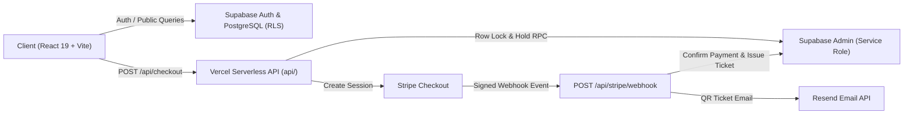

# Khaleeji Tour — Event Booking & Ticketing Platform

A full-stack event booking, interactive table reservation, and digital ticketing platform built with React, Vite, Tailwind CSS, Node.js, Vercel Serverless Functions, Supabase (PostgreSQL, Auth, Storage), Stripe, and Resend.

Production Website: [https://khaleejitour.com](https://khaleejitour.com)

---

## Key Features

- **Event Discovery & Multilingual Details**: Browse upcoming live events with full English and Arabic (`en` / `ar`) localization, RTL/LTR layout switching, SEO pre-rendering, and dynamic XML sitemap generation.
- **Interactive SVG Seat & Table Selection**: Real-time table availability powered by Supabase, custom SVG floor plans with pan/zoom controls, table categories (`vip_room`, `vip_premium`, `vip_standard`, `general`), and server-enforced reservation holds.
- **Stripe Checkout & Idempotent Webhooks**: Server-side reservation locking, coupon discount validation with 13% HST calculation, Stripe Checkout session creation, and webhook signature verification (`POST /api/stripe/webhook`) as the authoritative payment confirmation source.
- **Digital QR Tickets & Gate Check-In**: Automatic unique ticket code (`KT-*`) and QR code generation upon payment confirmation, digital ticket viewing/download, and a live gate scanner (`html5-qrcode`) for staff check-in.
- **Press Conference Registration**: Dedicated registration flow with automated confirmation emails, QR pass generation, and admin registration management.
- **Admin Dashboard & Manual Offline Booking**: Role-based access control (`admin`, `editor`, `gate_staff`, `customer`), event & seat-map management, coupon management, table blocking, booking reports, and cash/WhatsApp manual booking issuance.
- **Theme Support**: Light, Dark, and System theme switching via `next-themes` with semantic CSS design tokens.

---

## Technology Stack

| Layer | Technologies |
| :--- | :--- |
| **Frontend** | React 19, Vite 8, React Router v7, Tailwind CSS v4, TanStack Query v5, React Hook Form, Zod, `react-i18next`, `next-themes`, `lucide-react`, `html5-qrcode`, `html-to-image` |
| **Backend / API** | Node.js, Vercel Serverless Functions (`api/`), Express 5 (`back-end/server.js` for local development) |
| **Database & Auth** | Supabase PostgreSQL (Row-Level Security & RPCs), Supabase Auth, Supabase Storage |
| **Payments** | Stripe Checkout & Stripe Webhooks |
| **Email & QR** | Resend (transactional HTML/text emails), `qrcode` |
| **Tooling & CI** | `oxlint`, ESLint, Prettier, Node.js built-in test runner (`node --test`), GitHub Actions |

---

## Architecture Overview



- **Frontend (`book-ticket/`)** communicates directly with Supabase for public reads and authenticated user queries protected by PostgreSQL Row-Level Security (RLS), while all privileged operations (checkout, webhook processing, manual offline bookings, ticket verification) run exclusively on the server.
- **Serverless API (`api/`)** exposes Vercel Serverless Functions backed by shared business services in `back-end/services/`, middleware in `back-end/middleware/`, and email templates in `back-end/templates/`.

---

## Project Structure

```text
├── api/                          # Vercel Serverless Functions (checkout, webhook, tickets, cron)
├── back-end/                     # Shared server services, RBAC middleware, email templates, tests
│   ├── middleware/               # JWT & RBAC authorization middleware
│   ├── services/                 # Booking, Stripe, Ticket, Registration, Email, Health services
│   ├── templates/                # Transactional HTML & plain-text email templates
│   ├── utils/                    # Pricing & QR payload utilities
│   ├── tests/                    # Backend unit tests (node --test)
│   └── server.js                 # Local Express development server
├── book-ticket/                  # React 19 + Vite frontend application
│   ├── public/                   # Static assets, robots.txt, seat-map SVGs
│   ├── scripts/                  # Post-build SEO pre-renderer & sitemap generator
│   ├── src/
│   │   ├── components/           # UI, layout, auth guards, seatmap, booking, admin components
│   │   ├── contexts/             # AuthContext
│   │   ├── hooks/                # Custom React hooks & TanStack Query hooks
│   │   ├── layouts/              # MainLayout, AuthLayout, AdminLayout
│   │   ├── lib/                  # Supabase client, i18n, queryClient, Zod schemas, SQL migrations
│   │   ├── locales/              # English & Arabic translation files
│   │   ├── pages/                # Route pages (public, auth, booking, tickets, admin)
│   │   ├── services/             # Frontend API & Supabase service modules
│   │   ├── types/                # TypeScript definitions
│   │   └── utils/                # Seat map, SVG parser, image & storage utilities
│   └── tests/                    # Frontend utility unit tests (node --test)
├── docs/                         # Technical documentation (Architecture, DB, API, Dev, Deploy)
└── .github/workflows/            # CI & scheduled maintenance workflows
```

---

## Booking & Payment Workflow

1. **Table Selection & Hold**: Authenticated users select available tables on the interactive SVG seat map. Submitting checkout calls `POST /api/checkout`, which executes an atomic PostgreSQL RPC (`create_table_reservation`) to lock the selected seats for 15 minutes and create a `PENDING` booking.
2. **Server-Side Discount & Checkout**: If a coupon code is provided, the server validates it, computes the discount on the base ticket total before recalculating 13% HST, and creates a Stripe Checkout Session.
3. **Webhook Confirmation**: Stripe sends `checkout.session.completed` / `payment_intent.succeeded` to `POST /api/stripe/webhook`. After verifying the `stripe-signature` header, the server idempotently marks the booking `PAID`, converts seat holds to booked, generates a unique `KT-*` ticket with QR code, and sends confirmation emails via Resend.
4. **Expiration Cleanup**: Unpaid `PENDING` reservations are released automatically via scheduled cron (`POST /api/cron/expire-reservations`) and PostgreSQL cleanup RPCs.

---

## Local Installation & Running

### Prerequisites

- Node.js `>= 20`
- npm `>= 10`
- A Supabase project, Stripe test account, and Resend API key

### 1. Install Dependencies

```bash
# Install root/serverless dependencies
npm install

# Install frontend dependencies
cd book-ticket && npm install --legacy-peer-deps

# Install backend dependencies
cd ../back-end && npm install
```

### 2. Configure Environment Variables

Copy the example templates and provide your own test credentials:

```bash
cp book-ticket/.env.example book-ticket/.env
cp back-end/.env.example back-end/.env
```

See [docs/DEVELOPMENT.md](docs/DEVELOPMENT.md) for the complete list of variables.

### 3. Database Setup

Apply the SQL migrations in `book-ticket/src/lib/migrations/` sequentially in your Supabase SQL Editor. See [docs/DATABASE.md](docs/DATABASE.md) for schema and RLS details.

### 4. Run Locally

```bash
# Terminal 1: Start local Express backend (http://localhost:3001)
cd back-end && npm run dev

# Terminal 2: Start Vite frontend (http://localhost:5173)
cd book-ticket && npm run dev
```

---

## Testing & Code Quality

```bash
# Frontend lint, unit tests, and production build
cd book-ticket
npm run lint
npm test
npm run build

# Backend lint and unit tests
cd ../back-end
npm run lint
npm test
```

---

## Screenshots

Application screenshots are pending sanitized capture in `docs/screenshots/` (excluding customer PII, payment details, and live QR codes).

---

## Documentation

- [Architecture Overview](docs/ARCHITECTURE.md)
- [Database Schema & Migrations](docs/DATABASE.md)
- [API Reference](docs/API.md)
- [Development Guide](docs/DEVELOPMENT.md)
- [Deployment Guide](docs/DEPLOYMENT.md)
- [Security Policy](SECURITY.md)
- [Contributing Guidelines](CONTRIBUTING.md)

---

## Author

- **Name**: Ali Mohamed
- **Role**: Frontend Developer
- **Portfolio**: [https://ali-dev400.vercel.app/](https://ali-dev400.vercel.app/)

---

## Ownership & License Notice

This codebase was developed as a client production platform for **Khaleeji Tour**. No open-source license is granted by default; public redistribution or commercial reuse requires explicit authorization from the project owner.
