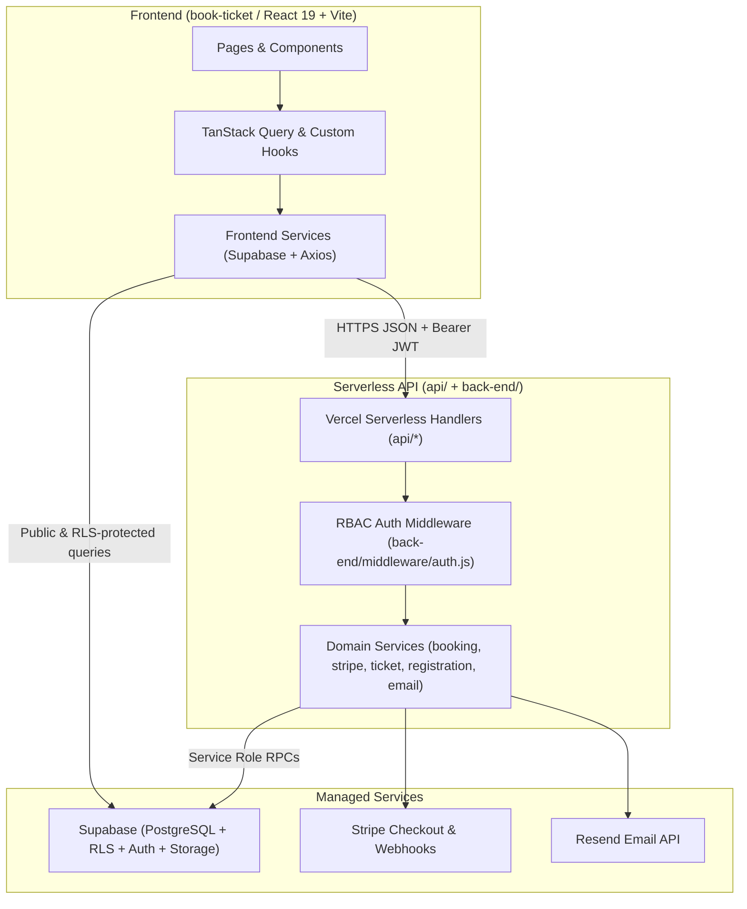

# Architecture Overview

## High-Level System Design

Khaleeji Tour uses a split **React SPA + Serverless API + Supabase PostgreSQL** architecture:

## Frontend Architecture (`book-ticket/src/`)

- **`pages/`**: Route-level components organized by domain (`events/`, `booking/`, `tickets/`, `auth/`, `admin/`, `legal/`, `errors/`), lazy-loaded via `React.lazy` and `Suspense` in `App.jsx` (with `HomePage` eager-loaded).
- **`components/`**: Presentational and feature components (`ui/`, `common/`, `layout/`, `seatmap/`, `booking/`, `events/`, `press-conference/`, `tickets/`, `admin/`, `auth/`).
- **`hooks/`**: Custom hooks wrapping TanStack Query (`useEvents`, `useSeatMaps`, `useBooking`, `useTickets`, `useCoupons`, `useUsers`, `useVideos`, `useRealtimeTables`).
- **`services/`**: Data-access layer separating Supabase queries and backend API calls from UI components.
- **`contexts/`**: `AuthContext` managing Supabase Auth session state and user profile roles.
- **`lib/`**: Shared configuration (`supabaseClient.js`, `queryClient.js`, `i18n.js`, `validations/authSchemas.js`, `migrations/`).

## Backend Architecture (`api/` & `back-end/`)

- **`api/`**: Vercel Serverless Function entry points (`checkout.js`, `booking.js`, `manual-booking.js`, `cleanup-expired.js`, `register-event.js`, `send-registration-confirmation.js`, `health.js`, `stripe/webhook.js`, `tickets/verify.js`, `tickets/event-attendees.js`, `cron/expire-reservations.js`).
- **`back-end/middleware/auth.js`**: Verifies Supabase JWT Bearer tokens, resolves `profiles.role`, and enforces RBAC (`admin`, `editor`, `gate_staff`) as well as `CRON_SECRET`.
- **`back-end/services/`**: Encapsulates business logic (`booking.service.js`, `stripe.service.js`, `ticket.service.js`, `registration.service.js`, `email.service.js`, `health.service.js`, `supabaseAdmin.js`).
- **`back-end/utils/pricing.js`**: Shared HST tax (13%), coupon discount math, and QR payload parsing.
- **`back-end/templates/`**: Responsive HTML and plain-text email templates.
- **`back-end/server.js`**: Express 5 wrapper for local development.
